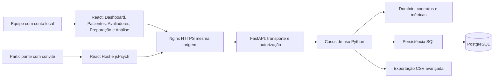

# Arquitetura WEB — atual, alvo e transição

Direção: [ADR-004](arquitetura/ADR-004-replanejamento-plataforma.md).
Estado observado: [auditoria](AUDITORIA_REPLANEJAMENTO.md). Este documento não
atribui aceite; execução e pendências pertencem ao [backlog](Projeto%20Stroop%20Test.md).

## Missão e fronteiras

Desenvolver uma plataforma Web modular para aplicação, gerenciamento e análise
de avaliações cognitivas, iniciando pelo Stroop Go/No-Go, com integridade de dados,
rastreabilidade metodológica, segurança e capacidade de expansão.

A tarefa experimental executa integralmente no navegador. Autenticação,
persistência, autorização e cálculo oficial usam a API própria; não se promete
operação offline. React/TypeScript/Vite, Python/FastAPI e PostgreSQL já existem.
O alvo é sua consolidação, preservando monólito modular e descartando a necessidade
de Streamlit na operação final. PsychoPy não será runtime Web.

| Fronteira | Responsabilidade e dependências permitidas | Situação / alvo |
|---|---|---|
| `web/src` React | Navegação, formulários, painel, cliente HTTP, apresentação | Existe; revisar fluxos e acessibilidade fora do caminho temporal |
| `web/src/experiment` | Máquina experimental, DOM isolado, captura monotônica | Existe com jsPsych/plugins próprios; validar antes de ampliar suporte |
| `api` | Contratos HTTP, cookies, erros seguros, routers, validação de entrada | Existe; sem regra científica duplicada |
| `stroop/domain` | Sem IO, HTTP, framework ou banco; classificação, métricas, integridade | Reutilizar como cálculo oficial |
| `stroop/ingestion` | Adaptadores CSV, registro explícito por instrumento | Depende do domínio; não importa UI |
| `stroop/application` | Casos de uso e coordenação transacional | Depende domínio/persistência, nunca CLI ou Streamlit |
| `stroop/persistence` | SQL e drivers SQLite/PG, permissões e transações | Isola leituras/escritas; schema público em scripts/migrations |
| `dashboard`, `.psyexp`, scripts locais | Compatibilidade e referência histórica | Legado em transição; retirada não autorizada nesta fase |

Não introduzir filas, microserviços, ORM, cadastro genérico de instrumentos ou
repositórios universais sem necessidade demonstrada. `test_code`/`test_version`,
registro de ingestão e casos de uso são pontos de extensão suficientes agora.

## Fluxo principal e estado

Alvo CHG-004: avaliador com login local → projeto autorizado → criação de avaliação/convite com
código pseudonimizado e visita → identificação por resgate → instruções → prática
→ principal no navegador → conclusão validada na API → transação PG → recibo →
métricas oficiais → painel React → exportação autorizada.

Alvo CHG-005 ([ADR-007](arquitetura/ADR-007-cadastros-centrais-e-exportacao-csv.md)):
**Login da equipe (conta local única) → Dashboard → Pacientes / Avaliadores → Preparar avaliação (seleção cadastral, geração automática de IDs e conferência) → Executar teste → Armazenar resultados → Consultar, analisar e exportar CSV.**
A importação manual de CSV deixa de existir no produto WEB; o CSV é estritamente formato de exportação.

Alvo CHG-006 ([ADR-008](arquitetura/ADR-008-simplificacao-estrutural-e-fluxo-direto-sessao.md)):
**Login da equipe (conta local única) → Painel unificado em 3 eixos fundamentais:**
- **Eixo 1 (Resultados e Análise Unificada):** Indicadores executivos (KPIs) + Barra unificada de filtros combinados reativos + Visualizações interativas descritivas + Histórico detalhado de tentativas + Hub de exportação CSV multi-granularidade sobre o recorte ativo;
- **Eixo 2 (Aplicação Direta / Nova Avaliação):** Formulário em etapa única estilo PsychoPy Runner (Participante + Visita + Projeto) com orquestração relacional atômica e seleção imediata de modalidade: *"Iniciar Agora neste Dispositivo"* (aplicação presencial direta com isolamento seguro pós-teste) ou *"Gerar Link / QR Code"* (aplicação remota/assistida com QR Code dinâmico);
- **Eixo 3 (Gestão Cadastral e Acessos):** Área secundária para manutenção aprofundada de fichas de pacientes e avaliadores, retificação auditada de vínculos de sessões (`relink`), gerenciamento de usuários locais, projetos e governança da equipe.

O código atual materializa a preparação via convite/sessão, não como resultado
oficial já criado. M2 deve manter distinta a avaliação planejada da concluída;
não renomear entidades nem criar cadastro de pessoa sem DEC-01.

Estados conceituais do navegador: identificação, instruções, prática, transição,
contagem, principal, envio, recebido, interrompido/expirado. Estados persistidos de
sessão e transições HTTP permanecem no [contrato API](desenvolvimento/CONTRATO_API_WEB.md).
A correspondência exata deve ser revalidada em WEB-006/WEB-013, sem substituir
esse contrato por outra enumeração independente.

React monta e destrói o Host; o plugin gerencia listeners, relógio e DOM, com
limpeza no unmount e prevenção de dupla execução. Principal usa performance.now
+ requestAnimationFrame; rede e relógio civil não medem RT. Registro distingue
condição-fonte, posição apresentada, versão experimental e versão do aplicativo.
Prática e regras temporais vêm do [protocolo](experimento/PROTOCOLO_WEB.md),
sem duplicar tempos neste documento.

## Integridade, falhas e recuperação

Atual: 16 tentativas principais ficam em RAM até POST de conclusão. Servidor
valida snapshot/ordem, números finitos, janelas/gates; deriva classificações,
normaliza ms para segundos e recalcula métricas no domínio. Uma transação grava
tentativas, métricas, proveniência, hash e recibo. Retry idêntico devolve recibo;
payload divergente conflita; commit não confirmado exige reconsulta antes de
reenvio. Nenhum resultado oficial parcial ou CSV parcial.

Interrupção do principal invalida execução e exige nova sessão/prática conforme
D2 já aprovado. Queda de rede após tarefa pode ser recuperada enquanto RAM/sessão
válidas; reload não recupera dados intermediários. Não persistir cookies,
credenciais, resultados ou convites em localStorage/IndexedDB/URL. O responsável rejeitou final-only em
2026-11-05. O
[ADR-005](arquitetura/ADR-005-persistencia-incremental.md) propõe checkpoints
por worker e preservação no servidor; estratégia e matriz de invalidação
foram validadas pelo responsável em 2026-11-05, após a proposta `270377b`.
Implementação e ensaios técnicos/temporais permanecem por executar. O parágrafo “Atual”
descreve a implementação existente, não o alvo aprovado. Não retomar principal
interrompido; parcial recebido não se torna resultado oficial.

Relógio civil UTC identifica eventos no servidor; relógio monotônico identifica
intervalos locais. Conferência server-side de coerência não prova onset físico.
M3 mede engenharia; M9 separa aceitação técnica, limitação metodológica e eventual
estudo de equivalência, que não é prometido pelo produto.

## Contratos de API

Fonte única dos corpos, limites, erros e papéis:
[CONTRATO_API_WEB](desenvolvimento/CONTRATO_API_WEB.md), confrontada com os routers
na tarefa WEB-005. Operações já presentes, a revalidar:

| Grupo sob /api/v1 | Operação / vínculo planejado |
|---|---|
| auth/login, me, logout, password | Alvo (implementado em M6): senha local no backend e sessão opaca; callback Google cortado fora de `APP_ENV=test` |
| patients e evaluators | Alvo CHG-005 (`WEB-045`/`047`): CRUD centralizado, busca de duplicidade/homônimos, inativação lógica e histórico longitudinal |
| projects e members | Criar/listar projetos e vínculos explícitos por papel |
| projects/{id}/invitations | Alvo CHG-005 (`WEB-046`): seleção de paciente e avaliador, instrumento, visita e iniciais, geração automática de códigos, conferência e convite de uso único |
| participant/redeem, session, start, abort, complete, logout | Fluxo experimental isolado da sessão profissional + checkpoints incrementais (`ADR-005`) |
| projects/{id}/assessments, options, detalhe/export | Lista/facetas/detalhe/tentativas/CSV por escopo autorizado com catálogo expandido de filtros (`WEB-017`/`019`) |
| projects/{id}/imports/{operation_id} | Presente no código atual; **a retirar da interface e do modo produto em M7 (`WEB-025`)** |
| exports/preview, exports/download, assessments/export | Alvo CHG-005 (`WEB-020`): exportação CSV avançada multi-granularidade com pré-visualização, seleção de colunas e critérios aplicados |
| admin/users | Gestão de contas sem excluir coletas nem desproteger último administrador |
| /health/live e /health/ready fora do prefixo | Saúde mínima e migrations compatíveis; nunca aplicar schema automaticamente |

Esta tabela agrupa famílias; os caminhos e métodos exatos são os do contrato.
Não criar novas rotas por inferência desta visão. Alterações exigem comparação de
payloads, testes negativos e atualização de rastreabilidade antes de codificar.
Campos fechados, JSON finito, limites de bytes, paginação estável e erros
sanitizados continuam obrigatórios. CSRF/origem em escritas; consulta e exportação
reautorizam. Cliente usa mesma origem e caminhos relativos, sem CORS irrestrito.

## Autenticação e autorização

Alvo aprovado em CHG-004: [ADR-006](arquitetura/ADR-006-autenticacao-local.md)
substitui Google OIDC por login local com conta administrativa única, sem
cadastro público. Regras completas de credencial, bootstrap/recuperação,
antiabuso e sessões em [autenticação](seguranca/AUTENTICACAO_E_PERMISSOES.md#autenticação-local--especificação-alvo-chg-004),
e transporte em [contrato](desenvolvimento/CONTRATO_API_WEB.md#autenticação-local--contrato-alvo-chg-004).
Conta técnica tem privilégios administrativos, mas precisa de vínculo explícito
para cada projeto/dado/convite. Conta compartilhada não atribui autoria individual
nem autoriza uso real; DEC-03 deve avaliar adequação e R12.

O código auditado ainda usa OIDC `iss/sub`, state/nonce/PKCE e expiração do
provedor; não há implementação local aceita. Reutilizar cookies opacos por hash,
CSRF/Origin, autorização no backend, guards e grants, adaptando identidade e
prazos via evolução aditiva. Não falsificar claims Google nem transferir testes
OIDC para aceite local. Sessões de participantes por convite permanecem distintas.
Migração/corte/rollback estão no ADR-006 e impactos de schema no modelo de dados.

## Modelo lógico

Detalhe de campos e fórmulas: [modelo canônico](dados/MODELO_DE_DADOS.md).
Entidades existentes, sem plano de recriação:

- Núcleo: assessments → trial_results e assessment_metrics.
- Identidade: app_users, eventos de auditoria, transações/sessões profissionais.
- Operação WEB: projetos, membros, convites, sessões participantes, limites.
- Proveniência: web_assessments e web_trial_observations; resultados WEB usam
  participant_name=NAO_COLETADO e initials nulo; source_file técnico web:session.
- Compatibilidade: mapa explícito web_legacy_project_links, auditoria de importações.

Nomes completos/DDL são os das migrations 0001–0010, não uma proposta de schema.
DEC-01 aprovou participante por projeto, visitas e múltiplas avaliações por
convite; entidades e evolução aditiva futura estão no
[modelo](dados/MODELO_DE_DADOS.md). Não há cadastro longitudinal central nesta versão.
Não há migração automática
de dados históricos por coincidência textual. Migrations são imutáveis/aditivas,
executadas separadamente por owner/migrador; runtime writer/reader restritos.
Contrato de retorno de ausência de RT distingue sentinela persistida e null/traço
na UI; mudar armazenamento depende de avaliação de compatibilidade.

## Testes e desenvolvimento local

Reusar comandos/locks existentes; não instalar ferramentas para esta fase.
Futuras unidades: unittest focado e regressão Python; PG descartável cujo nome
comece por stroop_etapa4_test; Vitest/DOM; typecheck/build; Playwright
Chromium/Firefox; HTTPS real com API/PG e papéis provisionados; testes de falha,
concorrência, rollback e autorização negativa. Doubles isolam lógica, não aprovam
integração. Medição física é campanha separada com equipamento/protocolo aceitos.

Guia local: [API](../api/README.md), [Web](../web/README.md),
[Compose isolado](operacao/WEB_DOCKER.md) e [CI](desenvolvimento/CI_WEB.md).
Vite é ferramenta de desenvolvimento/build, não servidor de produção.
Artefatos de teste são sintéticos, fora de coletas existentes; sem leitura de .env
operacional. O caminho de execução precisa ser reproduzido em checkout isolado
em M1, sem supor que dependências instaladas impliquem suite aprovada.

## Segurança, produção, migração e rollback

Dados pseudonimizados continuam potencialmente pessoais. Minimização, acesso por
projeto, auditoria sem payload/claims, logs seguros, exportação explícita e
retenção fundamentada. DEC-03 define política institucional aplicável antes de
coleta real; não inventar base legal/prazo. Reusar threat model, tratamento de
dados e resposta a incidentes; revisão M6 cobre XSS/CSRF/IDOR e vazamentos.

Compose/Nginx/HTTPS já existem com banco/API internos, apenas proxy publicado,
segredos externos, limites e imagens fixadas. M8 revalida build, grants, backup
criptografado, réplica externa e restauração isolada; M10 inclui WEB-041 para implementar a configuração research já prevista no
contrato de acesso, após aprovação institucional e autorização específica, com
barreiras negativas e revalidação dos gates afetados. M10 exige autorização
específica de produção, backup recente e retorno ensaiado. CI existente não faz
deploy; manter gatilhos e proteções. CI futura formal deve ser adaptada ao fluxo
sem PR sem reduzir checks, mediante procedimento documentado e autorizado.

Migração incremental: congelar referência → baseline testada → consolidar
contratos/dados e motor → integrar operação segura → comprovar paridade de
capacidades → homologar → publicar de forma controlada. Streamlit/CSV/CLIs
continuam enquanto houver cobertura/aceite pendente. Nenhuma retirada destrutiva
é necessária para fechar transição; desativação posterior exige autorização.
Rollback usa imagem anterior compatível com schema aditivo e revalidação de
consulta/exportação; não executar down migration destrutiva. Restauração ocorre
primeiro em ambiente isolado, com chave separada e ensaio de RPO/RTO; não afirmar
recuperabilidade só porque um arquivo de backup existe.

## Apresentação experimental — integração de CHG-003

Alvo de UX em [UX_DECISIONS](experimento/UX_DECISIONS.md), contratos preservados
em D1/D2/D5/D6; D3/D4 revisadas pelo proprietário no protocolo. Execução somente
no backlog. Variante `stroop-web-outline/1.0.0` no snapshot e sufixo visual em
app_version preservam proveniência sem alterar schema/persistência. `main-engine.ts` e
`practice-engine.ts` continuam donos do DOM/HUD e do relógio monotônico, sob
plugins `main.ts`/`practice.ts`; `ExperimentHost` apenas monta/limpa. Contorno por
token visual uniforme, preenchimento do snapshot e centro do estímulo preservados.
HUD aprovado expõe somente progresso/etapa em prática e principal e tempo
decorrido apenas no principal, conforme D3; nenhum nó ou
conteúdo acessível de precisão agregada. Não levar cronômetro ou quadros ao React.

A retirada da precisão é de apresentação: domínio Python, resumo técnico em RAM,
persistência, API, exportação e gráficos administrativos mantêm métricas oficiais.
Contadores locais que servem ao feedback individual da prática não devem ser
eliminados com o componente. Não há HUD React compartilhado com o dashboard;
evitar refatoração ampla para unificá-los. Componentes/tokens compartilhados de
UI são revalidados em M5 somente onde reutilizados. M4 integra instruções e
estados de envio/recibo com ADR-005. M9 valida protocolo visual e limitações;
CHG-003 não altera fronteiras, schema, transporte, segurança ou libera produção.

`web/src/experiment/presentation.ts` agora concentra somente o DOM de progresso
e cronômetro dos dois plugins; não contém timers, captura ou fórmula científica.
Motores entregam número de concluídas e elapsed, preservando agendamento/RT.
Estilos em `styles.css` aplicam contorno apenas durante a palavra-estímulo,
com token uniforme. Metadados `visual` no snapshot e sufixo visual em app_version
identificam esta revisão; a persistência e os contratos fechados não mudam.

## Evolução funcional e UX administrativa — integração de CHG-005

Conforme [ADR-007](arquitetura/ADR-007-cadastros-centrais-e-exportacao-csv.md) e a revisão de `DEC-01` (2026-11-07):

1. **Separação entre autenticação e identificação do avaliador:** a conta local única (`ADR-006`, concluída em `M6`) autentica o acesso da equipe à aplicação (`principal_id`), enquanto a entidade central `web_evaluators` identifica nominalmente e por código automático (`evaluator_code`) o avaliador responsável selecionado em cada sessão/avaliação.
2. **Cadastro centralizado de pacientes (`web_patients`) e avaliadores (`web_evaluators`):** implementados em `M4` (`WEB-045`, `WEB-046`) e expandidos em `M5` (`WEB-047`), com geração automática de identificadores internos estáveis (`UUID` e `participant_code`/`evaluator_code`), verificação de duplicidade e homônimos, inativação lógica sem exclusão destrutiva (`ON DELETE RESTRICT`) e reutilização transversal entre projetos, visitas, instrumentos e sessões.
3. **Formulário completo de preparação da avaliação (`WEB-046`):** recupera os campos pertinentes do formulário original do PsychoPy Builder (`project`, `participant_id` automático, `participant_name`, `initials`, `visit`, `evaluator` e `test_code`), com preenchimento por seleção cadastral e etapa de resumo para conferência antes da emissão do convite.
4. **Retirada da importação CSV do produto (`M7` / `WEB-025`):** dados operacionais são cadastrados e coletados diretamente no sistema; a tela `CsvImportPanel` e o upload CSV pelo usuário são retirados do produto WEB, mantendo módulos internos de ingestão/CLIs isolados para compatibilidade histórica e migração técnica autorizada.
5. **Reformulação da interface administrativa, filtros e exportação CSV avançada (`M5` / `WEB-017`–`WEB-020`, `WEB-047`):** a área profissional organiza-se em `Visão geral (Dashboard)`, `Pacientes`, `Avaliadores`, `Preparar avaliação`, `Avaliações e histórico`, `Resultados e análises`, `Exportações` e `Administração/configurações`, com catálogo completo de filtros combinados, visualizações interativas descritivas e exportação CSV em múltiplas granularidades (`pacientes`, `avaliacoes`, `tentativas`, `metricas` e `stroop_21_colunas`), sem tocar no motor experimental jsPsych.

## Simplificação estrutural em 3 eixos fundamentais e fluxo direto de avaliação — integração de CHG-006

Conforme estabelecido na [ADR-008](arquitetura/ADR-008-simplificacao-estrutural-e-fluxo-direto-sessao.md) (2026-11-08), a plataforma Stroop Web reorganiza a experiência de uso da equipe clínica e de pesquisa, consolidando os 8 módulos anteriores em **3 eixos fundamentais** e introduzindo o fluxo direto de avaliação em etapa única:

### 1. Modelo Mental Inspirado no Streamlit (3 Eixos de Navegação)

Para eliminar a fragmentação operacional decorrente da dispersão em 8 abas independentes, a interface da equipe (`/equipe`) passa a estruturar-se em:

1. **Eixo 1: Resultados e Análise Unificada (`/equipe/analise` ou visão principal):**
   - Centraliza em tela única coesa o ciclo completo de análise: KPIs executivos do projeto, catálogo de filtros combinados reativos (`REQ-REL-004`), gráficos interativos longitudinais e por condição Go/No-Go (`REQ-REL-005`), tabela detalhada de tentativas com metadados de proveniência e o hub integrado de exportação CSV multi-granularidade (`REQ-CSV-005`).
   - Reatividade tipo Streamlit: qualquer ajuste nos filtros atualiza de imediato os gráficos, tabelas e o escopo do download CSV, sem alternância de abas.
2. **Eixo 2: Aplicação Direta / Nova Avaliação (`/equipe/nova-avaliacao`):**
   - Fluxo sem fricção inspirado no PsychoPy Runner: um único formulário enxuto para informar Identificação do Participante (busca rápida ou criação transparente pelo nome), Visita (ex.: V1, V2) e Projeto/Avaliador contextual pré-selecionados (`REQ-SESS-001`).
   - Modalidades duais de disparo imediato (`REQ-SESS-002`):
     - *"Iniciar Agora neste Dispositivo"*: direciona o navegador local diretamente ao motor psicométrico jsPsych, ocultando o painel da equipe para aplicação presencial no consultório/laboratório. Ao concluir ou interromper o teste, persiste os dados com recibo e bloqueia o retorno aos dados confidenciais de outros pacientes, exigindo confirmação/reautenticação da equipe.
     - *"Gerar Link / QR Code"*: emite o convite criptograficamente assinado de uso único e renderiza link direto com cópia rápida e QR Code em alta definição para leitura ótica por tablet/celular do participante em aplicação remota ou assistida.
3. **Eixo 3: Gestão Cadastral e Acessos (`/equipe/gestao`):**
   - Módulo administrativo secundário reservado à manutenção cadastral aprofundada de pacientes (`web_patients`) e avaliadores (`web_evaluators`), correção auditada de vínculos de sessões (`relink_assessment` e `relink_invitation`), gestão de usuários locais, projetos e trilhas de auditoria (`web_registry_audit_events`), preservando a rotina clínica diária livre de ruído burocrático.

### 2. Orquestração Relacional Transparente

A simplificação da UI não degrada a integridade do modelo relacional PostgreSQL:
- A cadeia composta pelas entidades `web_patients`, `web_evaluators`, `web_project_participants`, `web_participant_visits`, `web_participant_sessions` e `web_invitations` é preservada integralmente.
- O backend FastAPI provê orquestração atômica transparente (`REQ-SESS-003`): a submissão do formulário unificado resolve o paciente existente ou provisiona novo registro com código `PAT-...`, assegura o vínculo ao projeto, gera a visita e emite o convite e a sessão em uma única transação de banco.
- Elimina-se a exigência de cadastramento prévio obrigatório em múltiplas telas isoladas antes de aplicar uma avaliação.

### 3. Preservação Científica e Psicométrica Absoluta

- O motor experimental jsPsych (`web/src/experiment/`), o isolamento monotônico fora do React, a apresentação visual com contorno branco `stroop-web-outline/1.0.0` (`CHG-003`), a paleta de dez cores, o HUD sem precisão agregada e os gates temporais D5 permanecem 100% inalterados.
- A persistência incremental (`ADR-005` / `WEB-007`), o worker dedicado, a atomicidade e as 12 métricas oficiais Stroop (com tratamento de ausência de RT em omissões) mantêm-se exatamente conforme validados nas etapas anteriores.
