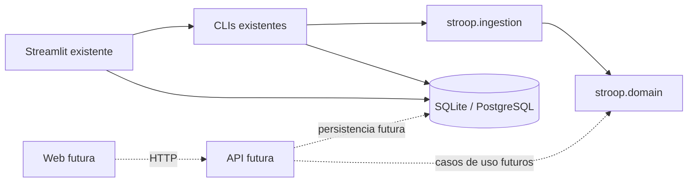

# ADR-001 — Evolucao web em monolito modular

Data: 2026-10-16. Decisao arquitetural adotada para orientar a implementacao.
Estado de execucao e aceite ficam somente no [roadmap WEB](../ROADMAP_WEB.md).

## Contexto observado

O repositorio possui uma tarefa PsychoPy, CLIs Python de importacao, SQLite,
PostgreSQL com migrations e um dashboard Streamlit com OIDC. Antes desta
reorganizacao, validacao, formulas e leitura CSV estavam no importador SQLite;
o registro de instrumentos precisava importar essa CLI para funcionar. Isso
acoplava uma regra reutilizavel ao adaptador de persistencia.

O dashboard ja separa composicao, componentes, transformacoes e acesso a dados.
PsychoPy referencia caminhos relativos de condicoes e assets. Os launchers,
Dockerfiles, CLIs e testes tambem possuem caminhos publicos documentados.
Nao ha justificativa para mudar todos esses caminhos na mesma entrega.

## Decisao

Manter um unico repositorio e adotar **monolito modular**, com dependencias
direcionadas para o nucleo Python. Aplicar separacao em camadas nos limites
necessarios; sem microservicos, barramento, filas, framework de repositorios
genericos ou biblioteca compartilhada entre Python e TypeScript.

| Area | Responsabilidade | Dependencias permitidas |
|---|---|---|
| `stroop/domain/` | Contratos, excecoes, validacao e metricas | Biblioteca padrao |
| `stroop/ingestion/` | Leitura CSV, selecao e normalizacao de instrumentos | `domain/` e biblioteca padrao |
| `scripts/` | CLIs e infraestrutura local existentes | Nucleo e drivers atuais |
| `dashboard/` | Adaptador Streamlit existente | Nucleo, dados e modulos atuais |
| `api/` | Futuro adaptador HTTP e composicao do backend | Casos de uso e infraestrutura |
| `web/` | Futura interface e execucao no navegador | Contrato HTTP e motor da tarefa |

Hoje `api/` e `web/` contem somente READMEs. A fronteira de persistencia ainda
esta nos importadores em `scripts/`; sua extracao posterior sera mecanica e
validada por paridade antes de criar rotas de escrita. Autorizacao e consultas
do dashboard tambem mantem seus locais atuais ate as etapas correspondentes.
Nao apresentar essas separacoes futuras como implementadas.

Os processos web e API sao unidades de execucao da mesma aplicacao, sem
servicos de dominio independentes. A estrutura Python fica em `stroop/` na
raiz, importavel no checkout e na imagem atual; nao introduzir instalacao
editavel ou tooling de monorepo apenas para resolver caminhos.

## Stack alvo e limites

- React e TypeScript para navegacao, formularios e painel web.
- jsPsych para a sequencia experimental e respostas do teclado.
- FastAPI/Python para HTTP e reaproveitamento do nucleo existente.
- PostgreSQL como persistencia web; SQLite continua no fluxo local.
- Docker Compose e Nginx existentes como base de integracao e operacao.
- Preservar Google OIDC e a identidade `iss` + `sub` para profissionais; o fluxo
  dos participantes e o escopo de acesso ainda exigem especificacao propria.

Essa escolha nao adiciona dependencias nesta entrega. Versoes, lockfiles e
compatibilidade serao verificadas na etapa que instalar cada componente.
Mudar a stack exige registrar um novo ADR com o motivo e impacto.

A tarefa mede intervalos no navegador do participante; nao usar tempo de ida e
volta ao servidor como tempo de reacao. O backend revalida consistencia e
recalcula metricas, mas nao consegue provar o instante fisico de apresentacao
ou de pressionamento apenas pelo payload recebido. Equivalencia de medicao
com o PsychoPy exige validacao propria; paridade das formulas e outro aceite.

## Compatibilidade preservada nesta reorganizacao

- `.psyexp`, condicoes, assets, tempos, HUD, formulas e CSV de 21 colunas.
- Caminhos de dados locais, schema e conteudo das migrations existentes.
- Launchers, CLIs, argumentos, codigos de saida e caminhos do dashboard.
- Imports anteriores de `scripts.importar_csv_sqlite` e `scripts.instrumentos`,
  inclusive as mesmas classes de excecao, por reexportacao explicita.
- Apenas uma implementacao das regras extraidas. Novos consumidores importam
  o pacote `stroop`, sem depender de uma CLI.
- `Dockerfile.dashboard` copia o novo pacote para manter a imagem funcional.

O analisador de linha de comando e o codigo embarcado no PsychoPy continuam
com suas implementacoes atuais. Nao unificar comportamentos de ausencia de RT,
arredondamento ou validacao nesta etapa: ha diferencas historicas a especificar
antes de uma consolidacao semantica.

## Consequencias e alternativas

Ganha-se reutilizacao das regras sem iniciar Streamlit nem importar drivers de
banco. A estrutura preserva uso por ZIP e testes `unittest`. O custo temporario
e manter reexportacoes e persistencia nos scripts ate a extracao prevista.

Recomecar o projeto descartaria testes e contratos uteis. Mover imediatamente
PsychoPy, dashboard, SQL e infraestrutura para novas arvores aumentaria o risco
de quebrar caminhos sem melhorar o limite principal. Uma arquitetura completa
com interfaces abstratas para cada funcao excederia a complexidade observada.

## Referencias

- [Mapa de arquivos](../ESTRUTURA_DO_PROJETO.md).
- [Decisoes metodologicas](../experimento/DECISOES_DO_EXPERIMENTO.md),
  [CSV](../experimento/CSV_UNIFICADO.md) e [modelo de dados](../dados/MODELO_DE_DADOS.md).
- [Pacotes Python](https://docs.python.org/3/tutorial/modules.html#packages).
- [Organizacao modular no FastAPI](https://fastapi.tiangolo.com/tutorial/bigger-applications/).
- [Execucao e servidor proprio no jsPsych](https://www.jspsych.org/v8/overview/running-experiments/).
- [Temporizacao no jsPsych](https://www.jspsych.org/v8/overview/timing-accuracy/).
