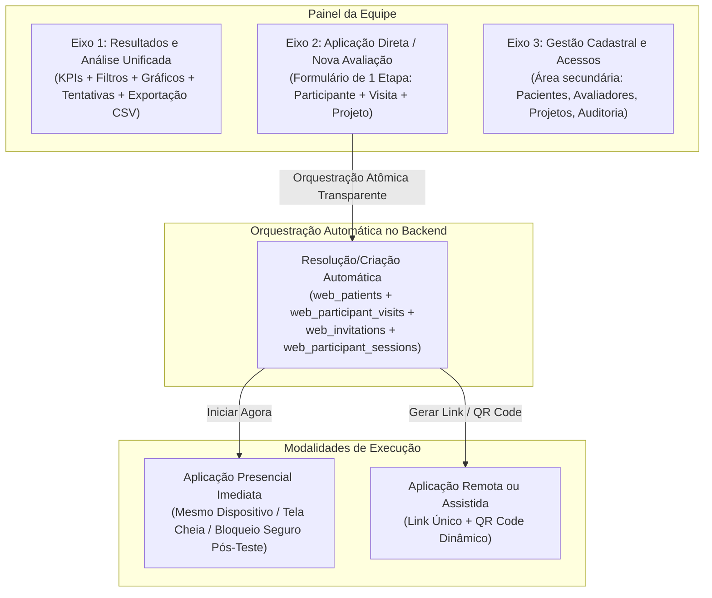

# ADR-008: Simplificação estrutural em 3 eixos fundamentais e fluxo direto de avaliação clínica

- **Status:** Aceito (direção arquitetural definida em `CHG-006` em 2026-11-08 pelo proprietário do repositório / responsável pelo produto e infraestrutura)
- **Data:** 2026-11-08
- **Decisores:** Proprietário do repositório / responsável pelo produto e infraestrutura
- **Rastreabilidade:** `CHG-006`, `ADR-007`, `ADR-006`, `ADR-005`, `ADR-004`, `DEC-01`, `DEC-02`, `DEC-03`, `DEC-04`, `M5`, `M7`, `WEB-046`, `WEB-028`, `REQ-INT-004`, `REQ-INT-005`, `REQ-SESS-001`, `REQ-SESS-002`, `REQ-SESS-003`, `REQ-REL-004`, `REQ-REL-005`

---

## Contexto e problema

Durante a execução do marco `M5` (concluído formalmente após a entrega de `WEB-017` a `WEB-020` e `WEB-047`, conforme [ADR-007](ADR-007-cadastros-centrais-e-exportacao-csv.md) e `CHG-005`), a plataforma Stroop Web implementou com sucesso a totalidade das capacidades granulares requeridas pelo grupo de pesquisa:
1. Cadastros centrais de pacientes (`web_patients`) e avaliadores (`web_evaluators`) com prevenção de homônimos e auditoria;
2. Formulário detalhado de emissão de convites com conferência;
3. Catálogo completo de filtros analíticos combinados (`REQ-REL-004`);
4. Visualizações interativas e histórico detalhado de tentativas com 12 métricas oficiais (`REQ-REL-005`);
5. Hub de exportação CSV multi-granularidade (`REQ-CSV-005`);
6. Administração local de acessos e correção auditada de vínculos (`relink`).

Entretanto, o desenho de navegação adotado distribuiu essas capacidades em **oito módulos/abas independentes** (`Visão geral`, `Pacientes`, `Avaliadores`, `Preparar avaliação`, `Avaliações e histórico`, `Resultados e análises`, `Exportações`, `Administração/configurações`). 

A avaliação operacional desse arranjo revelou uma divergência substancial frente aos modelos mentais de trabalho cotidiano da equipe clínica e de pesquisa:
- **Sobrecarga de alternância de abas:** para realizar um ciclo de análise exploratória, o pesquisador precisava consultar a "Visão geral", alternar para "Resultados e análises" para ver gráficos, ir para "Avaliações e histórico" para conferir sessões individuais e navegar até "Exportações" para baixar o CSV do recorte desejado, reaplicando ou revalidando critérios de filtro entre contextos distintos.
- **Fricção crítica no momento da coleta clínica (caso de uso presencial):** no consultório ou laboratório — ambiente primário do grupo de pesquisa —, a aplicação de uma avaliação a um participante requer agilidade imediata. No fluxo anterior em múltiplos passos, o operador precisava: (a) abrir a aba `Pacientes`; (b) cadastrar ou buscar o paciente; (c) abrir a aba `Preparar avaliação`; (d) preencher projeto, instrumento, visita e avaliador; (e) gerar o convite; (f) copiar a URL do convite ou abrir nova aba manualmente para que o participante realize o teste. Esse processo burocrático gera ansiedade no participante, perda de tempo clínico e risco de erros de operação.
- **Afastamento dos dois paradigmas de sucesso do projeto:**
  1. **Streamlit (análise rápida e reativa):** onde painel de controle, filtros unificados na lateral ou topo, métricas descritivas (KPIs), gráficos de distribuição, tabela detalhada de dados e exportação de CSV residem de forma coesa em uma única visão integrada e reativa.
  2. **PsychoPy Runner (aplicação direta e sem fricção):** onde o pesquisador apenas abre o diálogo de inicialização da sessão (`formulario_sessao`), digita o participante e a visita, clica em "Iniciar" e o teste roda no mesmo computador imediatamente, em tela cheia e sem desvios.

Fazia-se necessária uma reestruturação arquitetural que simplificasse a jornada operacional sem perder nenhuma das robustas garantias relacionais, de auditoria e de rigor psicométrico já validadas na base de código.

---

## Decisão

O projeto Stroop Web adota formalmente o **Replanejamento CHG-006**, consolidando a navegação da aplicação profissional em **3 eixos fundamentais** e introduzindo o **fluxo direto de avaliação em etapa única**, orquestrado de forma transparente sobre o modelo relacional existente.

### 1. Modelo Mental Inspirado no Streamlit: Redução para 3 Eixos Fundamentais

A interface da equipe (`/equipe`) substitui a proliferação de 8 abas isoladas por 3 eixos de atuação claramente delimitados:

#### Eixo 1: Resultados e Análise Unificada (Visão Analítica Principal)
Consolida em uma única experiência fluida e integrada todas as dimensões de consumo e extração de dados:
- **Painel Superior de Indicadores (KPIs):** total de participantes únicos, volume de avaliações concluídas válidas vs. parciais/invalidadas, taxa de adesão e resumos executivos das 12 métricas oficiais Stroop.
- **Barra/Painel Integrado de Filtros Combinados (`REQ-REL-004`):** permite recortar dinamicamente os dados por paciente/busca, avaliador responsável, projeto, visita, status da avaliação (`valid` vs. `invalid`/`interrupted`), faixas de tempo de reação (RT mediano) e precisão percentual, condição experimental (Go/No-Go) e tipos de resposta/erro.
- **Gráficos e Distribuições Visuais Interativas:** evolução temporal longitudinal do desempenho do paciente, curvas de distribuição de tempos de reação e comparação entre condições congruentes e incongruentes.
- **Tabela Descritiva e Histórico Detalhado:** listagem paginada de avaliações e tentativas com metadados de auditoria e proveniência técnica.
- **Hub de Exportação CSV Filtrada Integrado:** botão de exportação direta que extrai exatamente o subconjunto filtrado na tela, nas granularidades consolidadas (`pacientes`, `avaliacoes`, `tentativas`, `metricas` e `stroop_21_colunas`), com seleção de colunas e conformidade desidentificada/nominal (`DEC-03`).

#### Eixo 2: Aplicação Direta / Nova Avaliação (Fluxo Clínico sem Fricção)
Projetado segundo o modelo mental do PsychoPy Runner, voltado à agilidade de consultório e pesquisa de campo:
- **Formulário Unificado de Etapa Única:** uma única tela limpa e focada onde o operador informa:
  - **Identificação do Participante:** campo inteligente com autocompletar e busca instantânea por nome ou código existente (`PAT-...`), ou digitação imediata de novo nome para criação transparente;
  - **Visita:** seletor ou campo rápido (ex.: `V1`, `V2`, `Triagem`, `Reteste`);
  - **Projeto e Avaliador:** pré-selecionados automaticamente com base no contexto do operador autenticado e do projeto ativo, com possibilidade de troca rápida por lista suspensa autorizada;
  - **Iniciais do Participante:** autoderivadas ou pré-preenchidas a partir da identificação.
- **Seleção Imediata de Modalidade (Dois Modos de Disparo):**
  1. **"Iniciar Agora neste Dispositivo" (Aplicação Presencial Direta):**
     - O sistema gera a sessão de uso único e redireciona imediatamente o navegador atual para o motor experimental jsPsych (`/participante/executar?invitation=...` ou rota interna equivalente);
     - A interface administrativa é ocultada e a visualização é isolada;
     - O participante realiza as instruções, o bloco de prática e o teste principal Stroop no mesmo computador sob acompanhamento presencial do operador;
     - Ao concluir a avaliação (ou em caso de interrupção deliberada D2), os dados são salvos incrementalmente (`ADR-005`), o recibo de encerramento é exibido e a tela é bloqueada contra retorno acidental ao painel com dados confidenciais de outros pacientes, exigindo confirmação da equipe ou reautenticação para voltar à área administrativa.
  2. **"Gerar Link / QR Code" (Aplicação Remota ou Dispositivo Secundário):**
     - O sistema gera o convite único e apresenta em modal/card limpo o link direto (com botão de cópia rápida) e um **QR Code dinâmico** em alta definição para leitura direta por smartphone, tablet ou computador secundário do participante;
     - Oferece opção de envio facilitado e monitoramento em tempo real do status de abertura da sessão.

#### Eixo 3: Gestão Cadastral e Acessos (Área Administrativa e de Governança)
Área secundária e de bastidores, acessível pela equipe para atividades cadastrais, retificações e controle:
- Consulta aprofundada de fichas de pacientes e histórico de avaliações longitudinais;
- Consulta aprofundada de avaliadores responsáveis e histórico de aplicações;
- Procedimento auditado de retificação e revinculação de sessões (`relink_assessment` e `relink_invitation`);
- Administração de contas locais compartilhadas, permissões de projetos e trilhas de auditoria (`web_registry_audit_events`);
- Configurações do sistema.

---

### 2. Simplificação do Pipeline Operacional: Orquestração Relacional Transparente

A simplificação da experiência de uso não reduz a sofisticação do modelo de dados PostgreSQL. As tabelas `web_patients`, `web_evaluators`, `web_project_participants`, `web_participant_visits`, `web_participant_sessions` e `web_invitations` continuam sendo rigorosamente alimentadas e auditadas.

A inovação reside na **camada de orquestração atômica**:
1. Quando o operador submete o formulário de etapa única do Eixo 2:
   - Se o participante selecionado já possui registro em `web_patients`, o sistema reutiliza seu `id` e `participant_code`;
   - Se for informado um novo nome de participante, o backend localiza ou provisiona o registro em `web_patients` gerando o código `PAT-YYYYMMDD-NNNNNN` de forma idempotente e segura, resolvendo eventuais homônimos conforme regras de conformidade;
   - Assegura o vínculo do paciente ao projeto em `web_project_participants`;
   - Garante a existência do registro de visita em `web_participant_visits`;
   - Provisiona a sessão em `web_participant_sessions` com o `evaluator_uuid` selecionado;
   - Emite o convite criptograficamente assinado em `web_invitations`;
2. Toda essa sequência é executada em uma **única transação atômica** via endpoint otimizado (`POST /api/v1/projects/{project_id}/direct-evaluations`), retornando em milissegundos o convite emitido, a URL de execução e os dados para exibição do QR Code ou redirecionamento presencial imediato.
3. Elimina-se por completo a necessidade de navegações intermediárias ou cadastros prévios em telas isoladas para dar início a um teste.

---

### 3. Preservação Científica e Metodológica Estrita

A simplificação da navegação e do pipeline de preparação é estritamente de nível operacional e de UX. Os seguintes pilares científicos e de engenharia permanecem 100% inalterados:
- **Motor Experimental jsPsych (`web/src/experiment/`):** mantém-se rigorosamente isolado do ciclo de renderização do React.
- **Apresentação Visual Padronizada (`CHG-003` / `stroop-web-outline/1.0.0`):** os estímulos com contorno branco uniforme de 2px, a ausência de cartão de fundo, a centralização milimétrica e a paleta canônica de dez cores seguem intocados.
- **HUD e Regras Experimentais (`D1` a `D6`):** HUD limpo sem precisão ou acertos ao vivo, cronômetro discreto, contagem de progresso ordinal, prática de 4 tentativas (2 Go / 2 No-Go) e principal de 16 tentativas (8 Go / 8 No-Go).
- **Precisão Temporal e Gates D5:** limites de variação temporal de quadro (máximo 1 frame de desvio) e latência de transporte ativo validados em `WEB-011` e `WEB-012` seguem obrigatórios.
- **Persistência Incremental e Integridade (`ADR-005` / `WEB-007`):** envio tentativa a tentativa via Dedicated Worker, armazenamento com confirmação atômica no PostgreSQL, recibos criptográficos e exclusão estrita de dados parciais ou interrompidos dos conjuntos de resultados válidos.
- **12 Métricas Oficiais Stroop:** acurácia Go/No-Go, tempos de reação médios e medianos, contagem exata das 4 respostas possíveis (`hits`, `omission_errors`, `correct_rejections`, `commission_errors`) e tratamento de ausência de RT sem inserção de zeros fictícios.
- **Formatos Canônicos de Exportação:** CSV de 21 colunas canônico do Stroop e as quatro granularidades analíticas avançadas permanecem integralmente suportadas.

---

## Alternativas consideradas

1. **Manter a divisão da interface em 8 módulos separados (`CHG-005` original):**
   - *Avaliação:* rejeitada pelo proprietário. Embora funcionalmente completa, a proliferação de abas gerava alta fricção, fadiga de cliques e lentidão inaceitável na rotina clínica diária.
2. **Voltar ao modelo sem cadastro central de pacientes (digitação de ID manual isolado de `DEC-01` original):**
   - *Avaliação:* rejeitada. Reintroduziria a necessidade de planilhas externas para rastrear nomes de pacientes entre visitas e projetos, gerando inconsistências longitudinais. A solução correta é manter o banco relacional centralizado, mas automatizar sua criação e resolução de forma transparente na interface.
3. **Manter apenas o fluxo por Link externo (sem o modo presencial "Iniciar Agora"):**
   - *Avaliação:* rejeitada. O caso de uso mais frequente do grupo de pesquisa é a aplicação direta no consultório/laboratório, onde o participante senta-se em frente ao computador do próprio pesquisador. Obrigar o pesquisador a copiar links e abrir janelas avulsas prejudica a experiência e introduz falhas operacionais.

---

## Consequências

- **Positivas:**
  - **Experiência sem atrito (Zero Friction):** aplicação de testes clínicos com a agilidade do PsychoPy Runner e análise de dados com a fluidez do Streamlit;
  - **Redução drástica de tempo operacional:** início de um teste presencial em menos de 10 segundos, com 1 único formulário e 1 clique;
  - **Navegação coesa:** unificação do funil analítico (filtros + KPIs + gráficos + tentativas + exportação) em tela única reativa;
  - **Preservação relacional completa:** sem perda de rastreabilidade, auditoria ou metadados de pacientes, visitas e avaliadores no banco;
  - **Segurança pós-teste aprimorada:** bloqueio consciente da tela ao término do teste presencial, impedindo exposição indevida de dados da equipe ao participante.
- **Riscos e mitigações:**
  - *Risco de homônimos na criação automática pelo nome:* mitigado pela busca preditiva inteligente no formulário de etapa única, apresentando correspondências existentes com códigos e iniciais antes da submissão;
  - *Retorno acidental do participante ao painel da equipe no modo presencial:* mitigado pela destruição do token efêmero de execução e bloqueio de navegação com exigência de confirmação ou credenciais para reabrir o painel administrativo.
