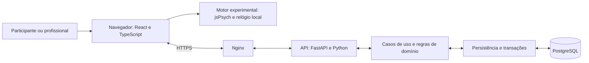

# Relatório técnico — funcionamento do Stroop Go/No-Go

Data de referência: 2026-10-16. Público: pesquisadores, colaboradores e pessoas
externas que precisam entender o sistema sem conhecer seu código.

Este relatório reúne uma explicação do experimento, dos cálculos, dos dados e
da aplicação. É uma síntese de leitura: as especificações vinculadas ao longo
do texto continuam sendo as fontes de cada contrato. Estado de implementação
e critérios de aceite permanecem no [roadmap WEB](../ROADMAP_WEB.md).

## 1. O que o projeto faz

O projeto aplica uma tarefa experimental de correspondência entre palavras e
cores, registra respostas e produz resultados descritivos para pesquisa.
A pessoa deve pressionar **Espaço quando o significado da palavra coincide
com a cor das letras** e aguardar quando forem diferentes. Por exemplo,
“VERDE” escrito em verde exige resposta; “VERDE” escrito em vermelho exige
não responder.

Essa combinação é chamada aqui de **Stroop Go/No-Go**: Go identifica as
tentativas em que se deve responder; No-Go, aquelas em que a resposta deve
ser inibida. Uma não resposta pode, portanto, ser o comportamento correto.
O resultado não é uma nota clínica, diagnóstico, percentil populacional ou
medida equivalente à de um produto comercial.

Existem dois caminhos que compartilham regras e contratos de dados:

| Caminho | Execução | Registro e consulta |
|---|---|---|
| Local, preservado | Experimento PsychoPy no computador | CSV oficial, importação para SQLite/PostgreSQL e dashboard Streamlit |
| WEB | Navegador com teclado físico | API Python, PostgreSQL e painel profissional web |

A versão experimental local é `0.2.2`; a variante WEB é `0.2.2-web.1`.
A versão do aplicativo é registrada separadamente: mudar uma tela não deve
apagar a identificação do protocolo usado em uma coleta.

## 2. Como acontece uma sessão

No fluxo local, o formulário anterior à tarefa identifica projeto,
participante, visita e avaliador. Na WEB, esses dados são fixados na criação
do convite: projeto, código pseudonimizado do participante, visita e identidade
técnica do profissional emissor. O participante não redefine esses campos
ao resgatar o convite. A API desse processo existe; sua tela de cadastro pela
equipe ainda é uma entrega planejada, não um recurso já disponível.

Depois das orientações, a pessoa faz uma prática de **quatro tentativas**:
duas Go e duas No-Go, com feedback após cada uma. Na WEB, pode repetir uma
rodada completa antes de continuar, sem nota mínima para avançar. O bloco
principal tem **16 tentativas**, sendo oito Go e oito No-Go, sem feedback por
tentativa. Somente o principal entra nas métricas oficiais.

As condições usam dez cores: verde, amarelo, rosa, preto, vermelho, laranja,
marrom, roxo, azul e cinza. A ordem é aleatória sem reposição das condições
da rodada; isso não significa frequência igual de cada cor. Na WEB, a ordem
principal é fixada na sessão pelo servidor e conferida no recebimento.

| Parte de uma tentativa | Prática | Bloco principal |
|---|---:|---:|
| Fixação, antes da palavra | 300 ms | 300 ms |
| Palavra visível e janela para responder | 2.000 ms | 2.500 ms |
| Intervalo sem estímulo | 500 ms | 950 ms |
| Total, sem feedback | 2.800 ms | 3.750 ms |
| Feedback posterior | 500 ms | Não existe |

As 16 tentativas principais somam **60 segundos nominais**. Esse tempo não
inclui formulário, instruções, contagens, prática ou navegação. Responder
antes do fim não encurta a tentativa. O indicador de precisão é acumulado
separadamente na prática e no principal; o cronômetro principal começa na
primeira tentativa principal. A precisão exibida ao vivo faz parte do
protocolo e pode influenciar o comportamento.

Na WEB, perder o foco, trocar de aba, recarregar ou usar Escape durante o
principal invalida a execução; não se salva uma avaliação oficial parcial.
Recomeçar exige nova sessão e prática. Na prática interrompida, reinicia-se
a rodada. O fechamento pode impedir o envio do aviso ao servidor; os prazos
da sessão continuam limitando uma conclusão posterior.

Detalhes e fronteiras: [protocolo WEB](../experimento/PROTOCOLO_WEB.md) e
[decisões do experimento](../experimento/DECISOES_DO_EXPERIMENTO.md).

## 3. Como cada resposta é classificada

| Condição apresentada | Resposta na janela válida | Classificação | Conta como correto? |
|---|---|---|---|
| Go: palavra e cor iguais | Espaço | Acerto, `hit` | Sim |
| Go: palavra e cor iguais | Nenhuma | Omissão, `omission` | Não |
| No-Go: palavra e cor diferentes | Nenhuma | Rejeição correta, `correct_rejection` | Sim |
| No-Go: palavra e cor diferentes | Espaço | Comissão, `commission` | Não |

Só a primeira nova pressão válida de Espaço conta. Repetição automática e
tecla mantida não geram respostas adicionais; é necessário soltar e pressionar
novamente. Teclas de navegação, cliques e pressões fora da janela não são
transportados para a tentativa seguinte. Escape tem função de interrupção.

O tempo de reação, ou **RT**, mede o intervalo entre o início registrado da
apresentação da palavra e a resposta, não o tempo desde a fixação. No
principal WEB, deve ser positivo e inferior a 2.500 ms; o fim da janela é
exclusivo. Há RT em acertos e comissões quando ocorre uma resposta, mas
**somente os RTs dos acertos Go entram na métrica agregada de resposta**.
Omissões e rejeições corretas não recebem um tempo de reação inventado.

## 4. Quais métricas são calculadas

Todas as fórmulas abaixo consideram apenas as tentativas válidas do principal.
No protocolo WEB atual, uma conclusão oficial exige o bloco completo de 16
tentativas; “válidas” não autoriza descartar erros de desempenho ou salvar um
subconjunto conveniente. Uma omissão ou comissão válida continua no denominador.

| Métrica | Cálculo ou significado | Unidade |
|---|---|---|
| Precisão total, `accuracy` | 100 × (acertos Go + rejeições corretas) ÷ total de tentativas | % |
| Precisão Go, `accuracy_go_trials` | 100 × acertos Go ÷ total Go | % |
| Precisão No-Go, `accuracy_no_go_trials` | 100 × rejeições corretas ÷ total No-Go | % |
| Omissões, `omission_errors` | Quantidade de tentativas Go sem resposta | Contagem |
| Percentual de omissões, `omission_errors_percentage` | 100 × omissões ÷ total Go | % |
| Comissões, `commission_errors` | Quantidade de tentativas No-Go com resposta | Contagem |
| Tempo de resposta, `response_time` | Mediana dos RTs dos acertos Go | Segundos |
| Totais, `total_trials`, `total_go_trials`, `total_no_go_trials` | Quantidades de tentativas do principal, Go e No-Go | Contagem |
| Acertos Go, `hits` | Quantidade de respostas corretas nas tentativas Go | Contagem |
| Rejeições corretas, `correct_rejections` | Quantidade de tentativas No-Go corretamente sem resposta | Contagem |

A **mediana** é o valor central dos tempos ordenados; quando a quantidade é
par, usa a média dos dois valores centrais. Não é a média aritmética de todos
os tempos. Cálculos preservam a precisão dos valores antes da formatação;
na tela final, precisão total é apresentada como percentual inteiro e RT
com três casas decimais, em segundos.

### Exemplo exclusivamente sintético

Suponha seis acertos Go, duas omissões, sete rejeições corretas e uma comissão:

- Precisão total: `(6 + 7) / 16 × 100 = 81,25%`.
- Precisão Go: `6 / 8 × 100 = 75%`.
- Precisão No-Go: `7 / 8 × 100 = 87,5%`.
- Omissões: duas, correspondendo a `2 / 8 × 100 = 25%` das tentativas Go.
- Se os seis RTs dos acertos forem `0,420; 0,480; 0,510; 0,550; 0,640; 0,800 s`,
  o tempo de resposta será `(0,510 + 0,550) / 2 = 0,530 s`.

Se não houver acertos Go, RT não pode ser estimado. A interface mostra `—`
e a API usa `null`. O núcleo/banco legado conserva um valor sentinela `0.0`
por compatibilidade; isso **não significa uma resposta instantânea**.
Oito omissões e oito rejeições corretas, por exemplo, geram 50% de precisão
total, mas nenhum RT de acerto.

No painel, precisão média e mediana agregam as precisões das avaliações
selecionadas. O RT mediano do conjunto é a mediana dos RTs-resumo disponíveis
de cada avaliação, não uma mediana de todas as respostas individuais reunidas.
São níveis de análise diferentes. Instrumentos distintos não devem ter suas
métricas misturadas.

Fonte de fórmulas: [modelo de dados](../dados/MODELO_DE_DADOS.md).
Implementação central: [núcleo Stroop](../../stroop/domain/stroop.py);
o [resumo do navegador](../../web/src/experiment/summary.ts) segue as mesmas
regras, verificadas com fixtures sintéticas compartilhadas.

## 5. O que acontece por trás da interface WEB

O sistema é um **monolito modular**: uma aplicação com responsabilidades
separadas em módulos, sem serviços de domínio independentes. Frontend, API e
banco são processos distintos, mas fazem parte do mesmo produto.

| Parte | Responsabilidade |
|---|---|
| React/TypeScript | Navegação, formulários, estados de envio e painel |
| jsPsych e motor da tarefa | Sequência experimental, teclado e apresentação local |
| FastAPI | Receber pedidos HTTP, validar formato, autenticar e controlar acesso |
| `stroop/domain` | Regras, classificações, validação experimental e métricas |
| `stroop/application` | Coordenar operações como concluir uma sessão e consultar resultados |
| `stroop/persistence` | Executar consultas e gravações transacionais |
| PostgreSQL | Guardar resultados, sessões, vínculos e informações de autorização |
| Nginx e Docker Compose | Expor HTTPS e executar os serviços com configuração operacional |

O navegador registra tempos com relógio monotônico e acompanha apresentações
por quadros. Um relógio monotônico mede intervalos sem depender de ajustes na
data/hora do computador. O servidor não fica comandando cada estímulo pela
rede: **tempo de requisição ou latência da internet não é usado como RT**.
Tempos observados trafegam em milissegundos; o RT canônico do CSV/banco usa
segundos. Datas civis identificam a coleta e não substituem esse cronômetro.

No encerramento do principal, o navegador envia os registros da execução.
O backend verifica sessão, prazo, ordem, protocolo, versões, número de
tentativas e consistência dos tempos/respostas; reconstrói classificações e
recalcula as métricas. Não aceita a pontuação calculada pelo cliente como
verdade sem conferência. Essa validação verifica coerência do relato, mas
não prova que a tela ou a tecla ocorreu fisicamente naquele instante.

A gravação da conclusão é transacional: avaliação, tentativas, métricas e
vínculo da sessão são confirmados juntos. Reenviar o mesmo resultado mantém
um único resultado e permite recuperar o recibo, enquanto a autorização e o
prazo forem válidos. Um resultado diferente para a sessão já concluída gera
conflito. **“Recebido pela equipe” depende de confirmação do servidor**.

Sem confirmação, o mesmo resultado pode permanecer em memória para reenvio,
conforme o prazo. O navegador não conserva respostas em armazenamento
persistente; fechar/recarregar pode perder um envio não confirmado.

Referências: [arquitetura](../arquitetura/ADR-001-evolucao-web.md),
[contrato HTTP](CONTRATO_API_WEB.md) e
[validação da conclusão](../../stroop/domain/web_results.py).
Os ADRs preservam o contexto de quando foram escritos; seus trechos que
descrevem componentes como futuros não substituem o estado atual do roadmap.

## 6. Quais dados ficam registrados

O banco separa a avaliação, suas métricas e cada tentativa:

| Conjunto | Conteúdo principal |
|---|---|
| `assessments` | Identificação da execução, projeto, participante, visita, avaliador e versão |
| `trial_results` | Condição, palavra/cor, resposta, RT e classificação de cada tentativa |
| `assessment_metrics` | Métricas calculadas, códigos e unidades |
| `web_assessments` | Vínculo com sessão/projeto, protocolo, versão do aplicativo, conclusão e recibo |
| `web_trial_observations` | Condição-fonte e instantes observados da tentativa WEB |
| Tabelas operacionais separadas | Contas, vínculos, convites, sessões e auditoria de acesso |

A exportação oficial Stroop conserva **21 colunas**, com metadados da sessão
e uma linha por tentativa principal. A prática não é exportada como resultado
oficial. A WEB mascara os campos históricos de nome/iniciais: usa
`participant_name=NAO_COLETADO` e iniciais vazias no CSV. Nomes de download
usam identificação do teste e horário, não identificação do participante.

O CSV de tentativas de uma avaliação não deve ser confundido com um CSV
agregado do dashboard, com uma linha por avaliação. Essa exportação agregada
da WEB está planejada e ainda não substitui a equivalente no Streamlit.

Registros locais antigos continuam reconhecidos como locais. A ausência de
protocolo, observações temporais ou fuso horário não autoriza inventar esses
valores. Para consultar legado pela WEB, é necessário um vínculo operacional
explícito com o projeto; coincidência de nomes de projetos não concede acesso.

Detalhes: [CSV oficial](../experimento/CSV_UNIFICADO.md),
[modelo de dados](../dados/MODELO_DE_DADOS.md) e
[vínculo do legado](../arquitetura/ADR-003-escopo-legado-web.md).

## 7. Quem pode acessar e como os dados são protegidos

Profissionais usam Google OIDC, um protocolo de autenticação que permite
verificar a identidade Google sem criar senhas próprias no produto. Login
não basta: a conta precisa estar cadastrada/ativa e ter o perfil e o vínculo
adequados ao projeto. Administrador global também precisa de vínculo para
ler os resultados de uma pesquisa.

Os três perfis são consulta, importação e administração. As permissões de
leitura/escrita são verificadas no servidor a cada operação, inclusive no
download. Algumas operações já têm API e ainda aguardam tela; outras, como
gestão WEB de contas e upload CSV, permanecem planejadas. A matriz completa
está em [acesso WEB](../seguranca/ACESSO_WEB.md).

Participantes usam convite de uso único, sem conta Google. O convite expira
em 24 horas; após resgate, a sessão dura 30 minutos, sem renovação automática.
Código do participante e número da visita identificam a coleta, mas não são
credenciais de acesso. Convites e cookies têm hashes armazenados no servidor;
as sessões profissional e participante são separadas.

HTTPS protege a comunicação. Cookies de sessão não podem ser lidos pelo
JavaScript da página; verificações de origem e tokens de proteção das escritas
reduzem o risco de outro site executar ações com a sessão do usuário. Há
limites de tamanho/frequência e erros públicos que não revelam detalhes
internos. A consulta de resultados usa credencial de banco dedicada à leitura.

A WEB não coleta nome, iniciais, CPF, contato, idade ou sexo de participantes.
A correspondência entre código e pessoa fica fora do sistema, sob custódia
da pesquisa. **Pseudonimização não equivale a anonimato**. Identificadores,
convites, credenciais e resultados não devem aparecer em logs públicos.

Na operação publicada, aplicação e banco são separados, e somente o proxy
expõe as portas web. Backups criptografados, ensaios de restauração e um plano
de retorno à versão anterior sustentam a recuperação. Objetivos de recuperação
não são garantias; a réplica externa automática ainda depende de destino
estável. Procedimentos técnicos ficam no
[guia de implantação e operação](../operacao/DEPLOY_WEB_VPS.md).

## 8. O que os testes demonstram — e o que ainda não demonstram

O projeto utiliza testes de regras e fórmulas, integração com PostgreSQL e
percursos em navegador, incluindo conclusão, repetição de envio, permissões
e exportação. Paridade de fórmulas demonstra que os mesmos registros produzem
os mesmos cálculos; ela não demonstra precisão física de apresentação.

O navegador depende do monitor, teclado, sistema operacional, frequência de
quadros e carga do computador. O alvo experimental WEB é desktop/notebook com
teclado físico, Windows/Linux e navegadores previstos no protocolo. Interface
responsiva não significa liberação experimental de celular ou de qualquer
outro ambiente. Homologação exige identificar e medir cada combinação.

O plano de engenharia prevê limites de desvio por quadro e no bloco de 60 s,
mas a aprovação do plano não equivale à execução dos pilotos físicos. Não se
afirma equivalência temporal ou psicométrica com PsychoPy, nem se usa esse
software como instrumento clínico validado.

A publicação existente é destinada a testes sintéticos. Cadastro da sessão,
complementos do dashboard e refinamentos de interface possuem entregas
pendentes; a homologação temporal e o aceite global não estão concluídos.
Este relatório não libera coleta real nem declara o produto finalizado.
O [roadmap](../ROADMAP_WEB.md) concentra o estado atualizado; as evidências e
limitações temporais estão em [validação WEB](../VALIDACAO_WEB.md).

## 9. Leitura complementar

| Para aprofundar | Documento |
|---|---|
| Regras e decisões metodológicas | [Decisões do experimento](../experimento/DECISOES_DO_EXPERIMENTO.md) |
| Sequência, tempos e fronteiras de resposta | [Protocolo WEB](../experimento/PROTOCOLO_WEB.md) |
| Fórmulas, campos e armazenamento | [Modelo de dados](../dados/MODELO_DE_DADOS.md) |
| Organização e limites dos módulos | [ADR-001](../arquitetura/ADR-001-evolucao-web.md) |
| Pedidos, respostas, autenticação e conclusão | [Contrato HTTP](CONTRATO_API_WEB.md) |
| Permissões e minimização | [Acesso WEB](../seguranca/ACESSO_WEB.md) |
| O que falta e o que foi validado | [Roadmap WEB](../ROADMAP_WEB.md) |

Este texto não altera fórmulas, protocolo, arquitetura ou permissões. Quando
esses contratos evoluírem, a síntese deve ser revista a partir de suas fontes.
